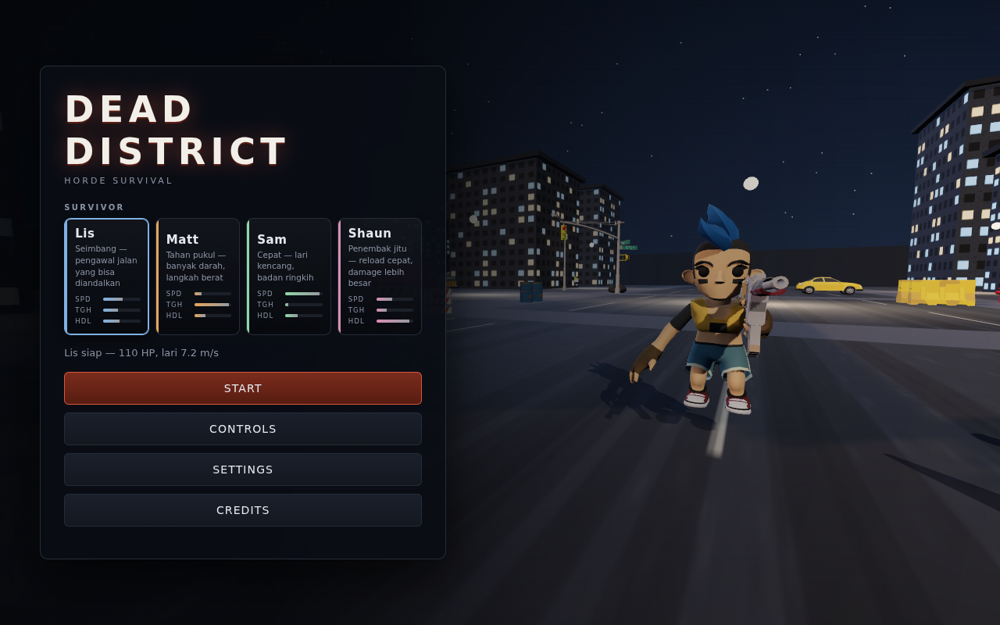
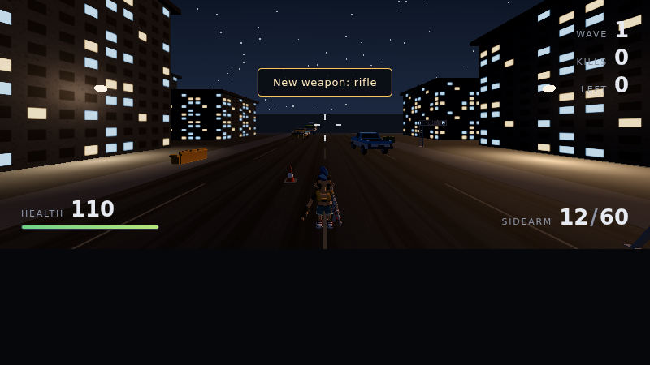
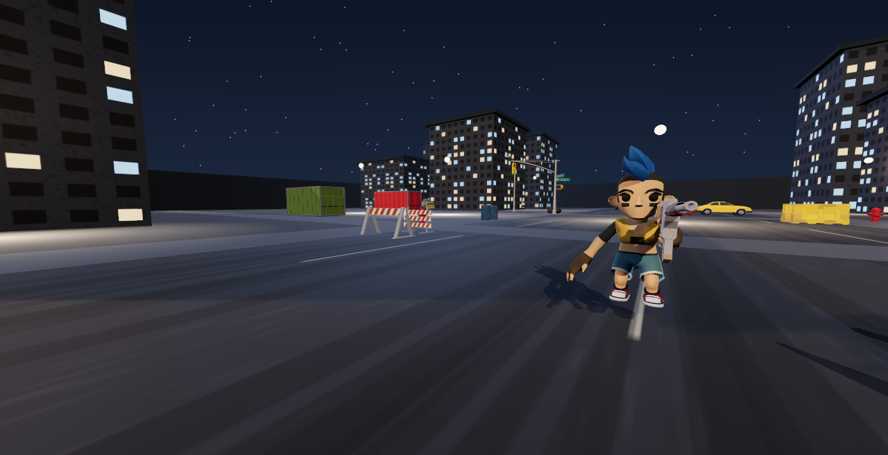
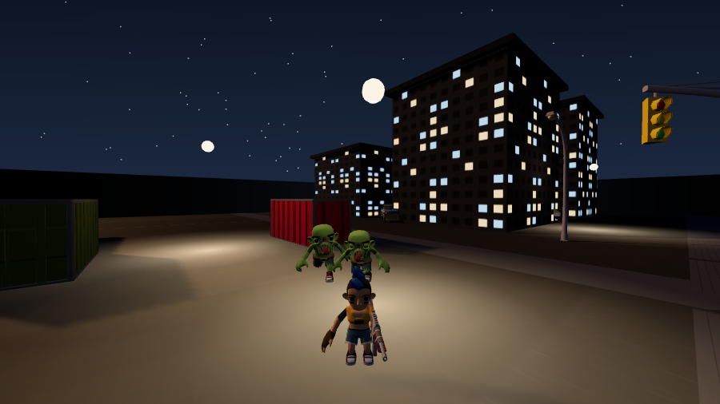
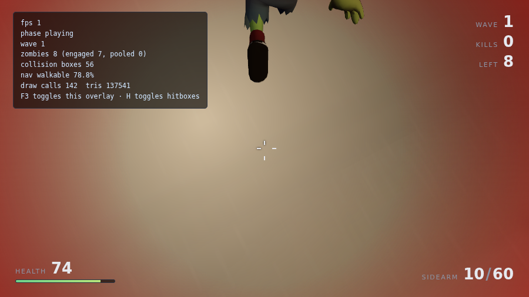
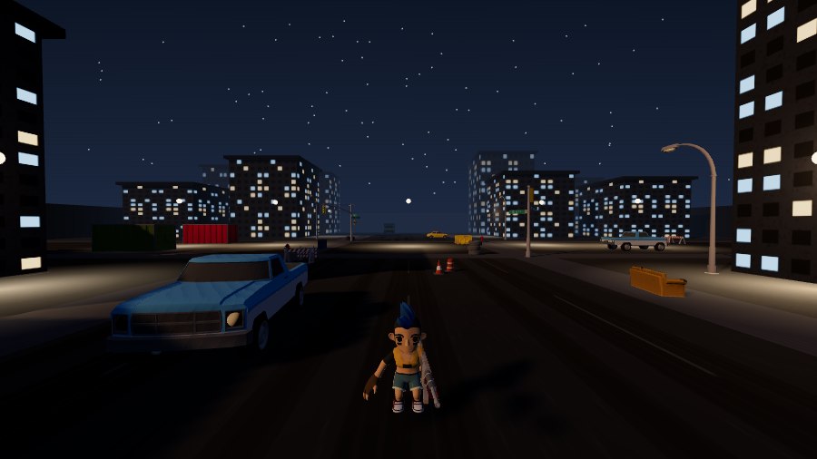
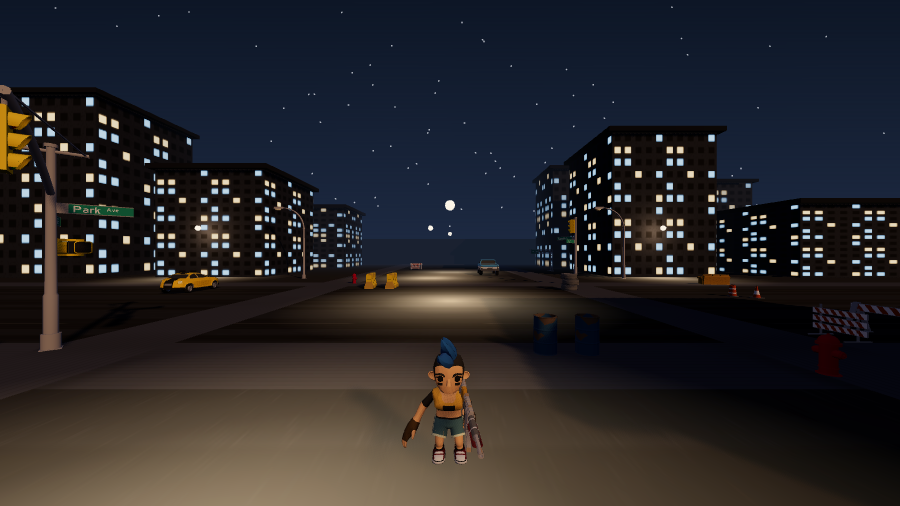
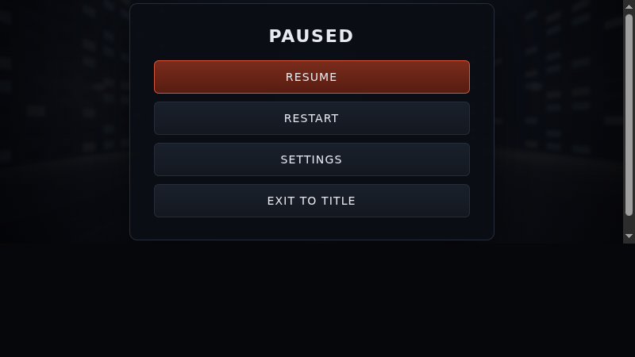
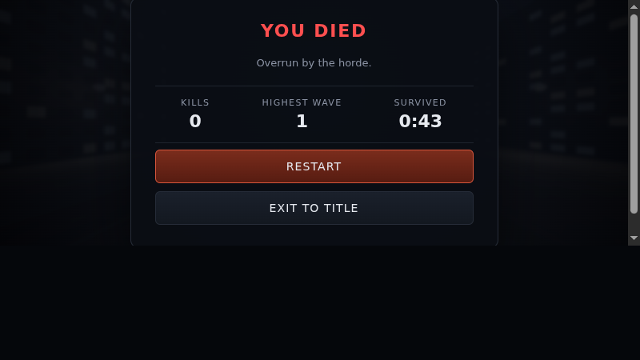

# Dead District — Horde Survival

Game **first/third-person survivor zombie 3D** yang berjalan langsung di browser desktop
memakai **Three.js + TypeScript**, tanpa backend, tanpa akun, dan tanpa API berbayar.
Pemain memilih satu dari empat survivor, menjelajahi satu ruas kota yang ditinggalkan saat
malam, dan bertahan dari gelombang zombie yang makin sulit.



> **Status:** tahap MVP yang sudah benar-benar bisa dimainkan. Semua yang diklaim di dokumen
> ini sudah dijalankan dan diverifikasi dengan harness otomatis — bukan mockup, bukan rencana.
> Lihat bagian [Verifikasi](#verifikasi) dan [Batasan yang diketahui](#batasan-yang-diketahui).

---

## Daftar isi

- [Apa itu game ini](#apa-itu-game-ini)
- [Fitur utama](#fitur-utama)
- [Cara main](#cara-main)
- [Empat survivor](#empat-survivor)
- [Musuh dan AI](#musuh-dan-ai)
- [Senjata dan combat](#senjata-dan-combat)
- [Wave dan kesulitan](#wave-dan-kesulitan)
- [Peta dan pencahayaan](#peta-dan-pencahayaan)
- [HUD dan menu](#hud-dan-menu)
- [Cara kerja teknis](#cara-kerja-teknis)
- [Performa terukur](#performa-terukur)
- [Verifikasi](#verifikasi)
- [Aset dan lisensi](#aset-dan-lisensi)
- [Batasan yang diketahui](#batasan-yang-diketahui)

---

## Apa itu game ini

Satu blok kota kecil saat malam. Kamu dan tiga survivor lain adalah orang terakhir yang
tersisa di jalan itu, dan gelombang zombie datang dari segala arah: trotoar, gang samping,
dan di antara kendaraan yang terbengkalai.

Yang membedakannya dari sekadar demo tembak-tembakan:

- **Zombie bukan kubus.** Karakter humanoid 3D bertekstur dari paket CC0 Quaternius, dengan
  rangka, animasi jalan/lari/attack/hit/death yang benar-benar dipakai lewat state machine.
- **Karaktermu kelihatan.** Kamera default **third-person**, jadi survivor yang kamu pilih
  terlihat berjalan, berlari, dan menggenggam senjata. Tekan `V` untuk first-person.
- **Zombie tidak berjalan menembus gedung.** Navigasi pakai grid A* 1 m yang dibangun dari
  geometri collision yang sama dengan yang menahan pemain.
- **Semua aset berlisensi jelas.** Seluruh model berformat glTF 2.0 dari paket **CC0 1.0**
  (public domain). Tidak ada aset yang di-hotlink dari server pihak ketiga saat runtime.

**Target platform:** browser desktop modern yang mendukung WebGL 2 dan Pointer Lock
(Chrome, Edge, Firefox, Safari). Kontrol utama keyboard + mouse. Mobile touch belum didukung.

---

## Fitur utama

| Sistem | Isi |
|---|---|
| Pemain | Gerak WASD relatif arah kamera, sprint, collision, head bob, health per-karakter, mati, restart |
| Karakter | 4 survivor bisa dipilih, model glTF beranimasi, senjata benar-benar di tangan |
| Kamera | Third-person (default) dan first-person, tombol `V`, arah bidik identik di kedua mode |
| Zombie | 3 tipe (Walker / Runner / Brute), state machine eksplisit, navigasi A*, animasi per keadaan |
| Combat | Hitscan raycast, hitbox kepala & badan terpisah, headshot, ammo, magasin, reload, recoil |
| Umpan balik | Hitmarker, damage vignette, muzzle flash, dan flare dampak pooled di titik tembakan |
| Wave | Gelombang bertambah besar, tipe musuh baru muncul di wave tertentu, jeda terdefinisi |
| Pickup | Medkit, amunisi, dan assault rifle muncul dari kill; tidak spawn di dalam benda padat |
| Ekonomi & toko | Poin dari kill (walker 5 / runner 8 / brute 25; headshot menggantikan nilai itu) + bonus wave; toko dengan preview 3D, dibuka dengan `B` antar-wave atau saat pause; progres tersimpan lokal |
| Peta | Blok kota 140 m: jalan, trotoar, gedung, container, kendaraan, pagar, lampu jalan, menara air |
| Pencahayaan | Langit gradasi senja + 420 bintang, matahari hangat rendah, 9 lampu jalan yang menyala |
| UI | HUD, layar judul + pemilihan survivor, pause, settings, controls, credits, game over |
| Audio | Efek suara disintesis dengan Web Audio API, ada master volume dan mute |
| Debug | Overlay FPS/entity/state (F3), tampilkan hitbox (H), preview karakter live di menu |

**Alur permainan:** layar judul → pilih survivor → Start (pointer lock diminta) → berebut
amunisi dan medkit di antara gelombang → mati → Restart.

---

## Cara main

### 1. Menjalankan

```bash
npm install
npm run dev          # buka http://127.0.0.1:5173/
```

Kalau dev server terasa lambat, jalankan versi produksinya tanpa bundler di tengah:

```bash
npm run build
node tools/static-server.mjs   # http://127.0.0.1:4173/
```

Buka URL yang tertulis, lalu klik **Start**. Kalau browser menolak pointer lock, klik sekali
lagi di area permainan — pesan pemulihannya muncul di layar, kontrol tidak akan mati diam-diam.

### 2. Kontrol

| Input | Aksi |
|---|---|
| `W` `A` `S` `D` | Bergerak (relatif ke arah kamera) |
| Mouse | Melihat / membidik (pointer lock) |
| `Shift` | Sprint |
| Klik kiri | Menembak (otomatis untuk rifle, satu per klik untuk pistol); mengayun saat senjata melee terhunus |
| `F` | Hunus senjata melee; tekan lagi untuk mengayun |
| `R` | Reload (juga otomatis kalau magasin kosong dan kamu menekan pelatuk) |
| `1` | Kategori primary (rifle, shotgun, smg, mp5, p90, lmg); tekan lagi untuk berputar ke senjata berikutnya di kategori ini |
| `2` | Kategori sidearm (pistol saja) |
| `3` | Kategori melee (knife, axe, bat berduri, spear, katana, machete, crowbar, sledgehammer, kapak pemadam); tekan lagi untuk berputar |
| `4` | Kategori ordnance (granat); klik kiri untuk melempar, jumlah terbatas dan dibeli di toko |
| `B` | Toko: buka/tutup (hanya antar-wave atau saat pause) |
| `V` | Ganti kamera: third person ↔ first person |
| `Esc` | Pause / melepas pointer |
| `F3` | Overlay debug (FPS, jumlah zombie, draw call, status AI) |
| `H` | Tampilkan hitbox zombie (hanya saat overlay debug menyala) |

### 3. Poin dan toko

Membunuh zombie memberi **poin**: walker 5, runner 8, brute 25. Headshot **menggantikan**
nilai itu, bukan menambahnya (walker 8, bukan 5 + 8), dan menyelesaikan satu wave memberi
bonus 50 + 10 × wave. Saldo tampil di HUD (baris `POINTS`) dan berkedip setiap kali bertambah.

Tekan `B` untuk membuka toko — hanya **antar-wave** (jeda setelah wave selesai) atau saat
pause; menekannya di tengah gelombang akan menolak dan memberi tahu alasannya. Item yang
dijual: barbed bat 250, spear 300, fire axe 350, assault rifle 700, SMG 800, dan pump shotgun
900 poin. Item yang belum terjangkau berharga merah dan tombol belinya mati; item yang sudah
dimiliki berlabel **OWNED**. Panel kanan menampilkan **preview 3D hidup** senjata terpilih,
dirender di canvas kecil dengan kamera dan lampu sendiri. Navigasi keyboard: `↑` `↓` memilih,
`Enter` membeli, `Esc` atau `B` menutup. Membeli langsung memasang senjatanya.

**Progres bersifat lokal per browser.** Poin, gear yang dimiliki, dan statistik disimpan di
`localStorage` dengan kunci berversi `dead-district:profile:v1`. Tidak ada backend dan tidak
ada akun, jadi membersihkan data situs akan menghapus progres. File simpan dengan versi skema
yang tidak dikenal diabaikan (kembali ke nilai awal) alih-alih dibaca setengah — tidak ada
yang dihapus.

### 4. Cara bertahan

- **Perhatikan bunyi dan pinggir layar.** Zombie datang dari gang samping, bukan cuma dari
  depan. Kamu tidak bisa bertahan hanya dengan menembak lurus ke jalan.
- **Kepala lebih efisien.** Hitbox kepala terpisah, jadi headshot benar-benar memberi bonus
  damage. Kalau model hanya punya satu hitbox, bonus itu tidak akan dipakai — di sini dipakai.
- **Amunisi habis lebih cepat daripada darahmu.** Rifle didapat dari pickup di jalan; medkit
  dan kotak amunisi juga muncul dari kill, jadi maju itu perlu, bukan pilihan.
- **Brute sejak wave 3.** Pindah posisi, jangan berduel jarak dekat — damage-nya berat.
- **Jangan biarkan kehabisan ruang.** Lebar jalan adalah sumber dayamu; kalau terjepit di
  sudut, segerombolan zombie akan menutup jalan keluar.



---

## Empat survivor

Pilih di layar judul; model yang dipilih langsung dirender hidup di jalan di belakang menu,
dengan rig lampu tiga titik sendiri. Karaktermu disimpan di `localStorage`, jadi tidak perlu
memilih ulang setiap kali.

| Survivor | Gaya | Health | Jalan / sprint | Reload | Damage |
|---|---|---|---|---|---|
| **Lis** | Seimbang | 110 | 4.4 / 7.2 m/s | 0.92× | 1.00× |
| **Matt** | Tahan pukul | 150 | 3.9 / 6.2 m/s | 1.15× | 1.10× |
| **Sam** | Cepat, ringkih | 85 | 4.9 / 8.4 m/s | 0.95× | 0.95× |
| **Shaun** | Penembak jitu | 100 | 4.3 / 6.9 m/s | 0.78× | 1.25× |

Angka-angka itu **benar-benar masuk ke sistem**, bukan label: health per karakter
(`PlayerHealth.setMaxHealth`), kecepatan gerak (`PlayerController.setSpeeds`), dan pengali
reload serta damage (`WeaponController.setCharacterModifiers` → `WeaponRuntime`).



---

## Musuh dan AI

Tiga tipe, semuanya dari paket CC0 yang sama:

| Tipe | Perilaku | Kekuatan | Kelemahan |
|---|---|---|---|
| **Walker** | Berjalan ke pemain, menyerang dari jarak dekat | Jumlah banyak, ancaman standar | Lambat, HP rendah |
| **Runner** | Berlari saat melihat pemain | Cepat, bisa mengepung | HP rendah |
| **Brute** | Bergerak lambat, serangan berat | HP tinggi, memaksa jaga jarak | Mudah dihindari, spawn terbatas |

Setiap zombie adalah **state machine eksplisit**: `SPAWN → IDLE/WANDER → CHASE → ATTACK →
HIT → DEATH → DESPAWN`.

**Catatan kejujuran soal model.** Walker dan Runner memakai **satu model yang sama**, dibedakan
lewat tint warna, skala 0.9×, dan kecepatan ±2×. Alasannya terukur: mesh alternatif
(`Zombie_Ribcage`) kehilangan `head`, `lowerarm`, dan seluruh jari, sehingga hanya **25,5 %**
track klip bisa di-bind ke rangka itu. Akibatnya ia tidak punya klip attack sendiri dan
memutar siklus jalannya saat menyerang — terlihat rusak. Tiga rig berbeda memang lebih bagus,
tapi satu serangan yang benar lebih penting daripada tiga siluet yang setengah jalan.

**Navigasi:**

- Grid A* dengan sel 1 m, dibangun dari kotak collision yang sama dengan yang menahan pemain.
- Path dihitung dengan **throttle**: satu permintaan per zombie setiap 0,85 detik, dan dihitung
  ulang hanya kalau pemain berpindah lebih dari 2,5 m dari target terakhir. Bukan setiap frame.
- Ada separation/steering ringan supaya zombie tidak menumpuk di satu titik yang sama.
- Jalur buntu ditangani dengan memilih rute alternatif atau reset path — zombie tidak macet
  selamanya.
- Zombie lebih jauh dari 32 m memperbarui AI-nya pada 12 Hz, bukan 60 Hz.
- Serangan memakai cooldown satu serangan, jadi berdiri di dekat zombie tidak menguras HP
  per frame.



---

## Senjata dan combat

- **Hitscan raycast** dari crosshair: ditembakkan dari posisi mata pemain sepanjang arah kamera.
- **Hitbox terpisah** kepala dan badan per zombie, sehingga bonus headshot nyata. Peluru
  berhenti di dinding, dan menembak dinding tercatat sebagai `combat:world-hit` — bukan
  damage ke zombie terdekat yang tidak kena ray.
- **Dua senjata:** pistol (semi-otomatis, magasin 12) dan assault rifle (otomatis, magasin 30)
  yang didapat dari pickup.
- Amunisi, fire rate, magazine, reserve, reload, recoil, muzzle flash, dan crosshair — semua
  nilai tuning ada di **satu file konfigurasi** (`src/app/gameConfig.ts`), tidak tersebar
  sebagai angka ajaib.
- **Melee** (pisau, kapak, bat berduri, tombak) memakai tabel sendiri di
  `src/app/meleeConfig.ts` dan `src/combat/MeleeSystem.ts`: satu ayunan = kerucut (arc) plus
  jangkauan (reach), bukan ray. Damage diterapkan sekali per ayunan, di tengah ayunan
  (35% durasi), bukan di frame pertama; dinding tetap memblokir — ayunan tidak menembus
  gedung. Tanpa bonus headshot, karena hit test melee memakai radius badan, bukan hitbox kepala.
- Umpan balik visual: hitmarker dengan perlakuan berbeda untuk headshot/kill, damage vignette,
  dan flare dampak singkat (0,26 detik) yang di-pool — hangat di geometri, merah di daging,
  lebih terang di kepala.



---

## Wave dan kesulitan

- Wave pertama datang setelah jeda singkat. Setiap wave lebih besar, dan komposisinya berubah:
  **Runner dari wave 2**, **Brute dari wave 3**.
- Zombie hanya muncul kalau modelnya benar-benar termuat — HUD tidak pernah mengklaim varian
  yang tidak ada di level.
- Spawn menghindari muncul tepat di depan kamera pemain dan tidak di area pandang langsung.
- Batas zombie aktif mengikuti preset kualitas grafis: **12 / 20 / 28** (low / medium / high).
- Jumlah 50–100+ zombie adalah eksperimen lanjutan, bukan klaim. Lihat
  [Performa terukur](#performa-terukur) untuk alasannya.

---

## Peta dan pencahayaan

Satu blok kota 140 m dengan jalan lebar untuk pertempuran dan jalur samping untuk flank.

- **Bangunan** memberi batas level yang jelas dan solid: tidak bisa ditembus pemain maupun
  zombie. *Bangunan tidak punya interior* — ini batas yang disadari, lihat
  [Batasan yang diketahui](#batasan-yang-diketahui).
- **Prop** dari paket yang sama: container, drum, pagar beton, kerucut lalu lintas, tumpukan
  ban, tong sampah, halte, kursi, peti, hidran, pipa, papan nama kota, menara air, dan enam
  kendaraan terbengkalai (dua di antaranya lapis baja).
- **Pencahayaan malam yang bisa dibaca:** langit gradasi senja dengan 420 bintang, matahari
  hangat rendah untuk bayangan panjang, ambient + hemisphere fill, dan **9 lampu jalan yang
  benar-benar menyala** — masing-masing dengan point light non-shadow dan kolam cahaya aditif
  di aspal.
- Tone mapping ACES dengan exposure disetel agar frame pertempuran tetap terbaca; keempat
  preset kualitas punya fog dan kerapatan prop sendiri.





---

## HUD dan menu

- **HUD:** health + bar, senjata, magasin/reserve, wave, kill, jumlah sisa, crosshair dengan
  bloom sesuai spread, toast notifikasi, dan prompt reload.
- **Layar judul** dengan pemilihan survivor, Controls, Settings, Credits.
- **Pause:** Resume, Restart, Settings, Exit to title. Saat pause, simulasi benar-benar berhenti
  — tidak ada tembakan atau damage di belakang menu.
- **Settings:** master volume, sensitivitas mouse, kualitas grafis, toggle shadow, toggle efek
  flash, toggle overlay debug. Semua tersimpan di `localStorage`.
- **Game over:** sebab kematian, kill, wave tertinggi, waktu bertahan, dan Restart.
- Input UI tidak pernah diartikan sebagai tembakan atau gerakan saat kursor berada di menu.





---

## Cara kerja teknis

**Stack:** TypeScript `strict: true`, Vite, Three.js, glTF 2.0 (`.gltf`) untuk seluruh model,
Vitest untuk logika yang bisa diuji tanpa WebGL, HTML + CSS biasa untuk HUD dan menu (bukan
mesh 3D), Web Audio API untuk suara, npm dengan lockfile tersimpan.

Tidak ada React, tidak ada state manager, tidak ada backend, tidak ada database, tidak ada
physics engine. Collision-nya kinematik sederhana yang ditulis jelas: pemain adalah lingkaran
yang didorong keluar dari kotak AABB oleh collision world.

```
src/
  main.ts               bootstrap saja (canvas + Game)
  app/                  Game orchestrator, tuning config, definisi survivor, event types
  core/                 game loop, state machine, event bus, asset loading
  engine/               pembuatan renderer, pencahayaan, rig lampu studio
  input/                keyboard/mouse, pointer lock
  player/               gerak + mode kamera, health, avatar yang terlihat, weapon controller
  combat/               aturan runtime senjata, resolusi damage hitscan
  zombies/              entity, state machine, animator, factory, director,
                        navigation grid, A* pathfinding, analisis animasi
  level/                blok kota, collision world, prop library, spawn points
  systems/              wave, pickup, audio, efek dampak
  ui/                   HUD, menu, settings store
  utils/                pencocokan klip, geometri karakter, tekstur, matematika
  styles/               CSS HUD/menu
tests/                  spesifikasi Vitest (tanpa WebGL)
tools/                  harness verifikasi browser + helper
docs/                   screenshot untuk README ini
```

Prinsip yang dijaga: `main.ts` hanya bootstrap; renderer bukan sumber kebenaran gameplay;
satu sumber kebenaran untuk fase `playing/paused/gameOver/loading`; subsistem berkomunikasi
lewat event bus atau API bertipe, bukan import melingkar; semua listener/timer bisa dilepas;
restart mengembalikan game ke satu state bersih.

---

## Performa terukur

Diukur di host pengembangan ini dengan `node tools/diag-performance.mjs` — **host tanpa GPU**
(software rendering), jadi baca *bentuknya*, bukan konstanta angkanya.

**Biaya simulasi per step**, pemain dikunci hidup supaya gerombolan tetap menghitung path
(kasus termahal), 600 step per tingkat:

| Zombie hidup | Terlibat | ms/step | Terhadap budget 60 Hz (16,67 ms) |
|---|---|---|---|
| 8 | 8 | 3,0 | 5,6× headroom |
| 24 | 22 | 11,0 | 1,5× |
| 48 | 44–45 | 11,7–25,7 | 0,6–1,4× |

Biaya menembus frame budget di suatu titik antara 24 dan 48 zombie yang mengejar, dan itulah
alasan cap 12/20/28 — sekaligus alasan target 20–30 zombie dari brief lebih tepat daripada
100+. Yang jadi batas adalah **simulasi**, bukan renderer.

**Beban rendering**, satu frame per tingkat, scene yang sama:

| Tingkat | Draw call | Triangle |
|---|---|---|
| low (shadow mati) | 460 | 401k |
| medium (shadow nyala) | 1369 | 522k |
| high | 1369 | 522k |

Pass shadow melipatgandakan draw call, itu sebabnya `low` mematikannya. Medium dan high hanya
berbeda pada resolusi shadow map dan cap pixel ratio — antialiasing ditetapkan saat context
dibuat dan kerapatan prop ditentukan saat level dibangun, jadi mengubah tingkat di tengah sesi
tidak bisa mengubah dua angka itu.

**Tidak ada klaim FPS.** Host ini tidak punya GPU, jadi angka FPS di sini tidak berarti apa-apa.
Yang dilaporkan hanya biaya CPU simulasi dan beban draw call, karena keduanya tetap relevan di
mesin nyata.

---

## Verifikasi

Semua yang diklaim di dokumen ini dihasilkan oleh pipeline yang bisa dijalankan ulang:

```bash
npm run typecheck        # tsc --noEmit, strict
npm run test             # Vitest, logika tanpa WebGL
npm run build            # bundel produksi
bash tools/full-check.sh # semuanya + harness browser (Chrome for Testing)
```

`tools/full-check.sh` menjalankan: penjaga kebijakan format aset → typecheck → unit test →
build → harness animasi → harness visual → smoke test end-to-end. Hasil terakhir:

| Gate | Perintah | Hasil |
|---|---|---|
| Kebijakan format | (tahap pertama `full-check.sh`) | **PASS** — tidak ada FBX dikirim, tidak ada dirujuk di source |
| Type check | `npm run typecheck` | **PASS** — tanpa error (strict) |
| Unit test | `npm run test` | **PASS** — 13 file, 118 tes |
| Build produksi | `npm run build` | **PASS** (~826 kB JS, 219 kB gzip) |
| End-to-end | `bash tools/full-check.sh` | **PASS** — 64/64 check |

Smoke test menjalankan Chrome sungguhan terhadap game dan memverifikasi **dengan assertion**,
bukan dengan melihat: boot tanpa aset gagal, pemetaan klip per state, Start → `playing`,
pemain benar-benar bergerak, zombie mengejar dan menyerang, hitscan mematikan zombie dan
menambah kill counter yang ditampilkan HUD, pause membekukan simulasi, restart bersih tanpa
membocorkan objek atau resource GPU, keempat survivor termuat dengan statistiknya, dan `V`
menukar kedua mode kamera dengan karakter yang benar-benar mengikuti pemain.

Screenshot di README ini **bukan mockup**: semuanya frame yang dirender game itu sendiri dan
diambil oleh harness otomatis ke `tools/shots/`, lalu salinan terpilih diletakkan di
`docs/screenshots/`.

---

## Aset dan lisensi

Seluruh model 3D berasal dari **Zombie Apocalypse Kit oleh Quaternius**, dilisensikan
**CC0 1.0 Universal (public domain)** — bebas dipakai untuk proyek pribadi maupun komersial,
tanpa kewajiban atribusi (atribusi tetap diberikan sebagai bentuk terima kasih).

- Halaman resmi: <https://quaternius.com/packs/zombieapocalypsekit.html>
- Semua model berformat **glTF 2.0**, diunduh dari build glTF resmi pack tersebut.
- `public/assets/` ±20 MB; hanya survivor yang dipilih yang diunduh saat bermain.
- Inventaris lengkap per file, tanggal pemeriksaan, dan catatan modifikasi ada di
  **[ASSET_CREDITS.md](ASSET_CREDITS.md)**.

**Tidak ada** aset dari Sketchfab atau Mixamo, **tidak ada** aset yang di-hotlink dari server
pihak ketiga saat runtime, dan **tidak ada** API key atau kredensial di repo ini. Efek suara
disintesis sendiri dengan Web Audio API; tekstur jalan, trotoar, dan fasad gedung digambar
secara prosedural oleh kode proyek.

> **Lisensi kode sumber belum ditetapkan.** Karena itu, secara default kode di repo ini
> "all rights reserved" — kamu boleh melihat dan mempelajarinya, tetapi belum ada izin
> eksplisit untuk memakai ulang. Aset CC0 di `public/assets/` tetap bebas dipakai sesuai
> lisensinya sendiri.

---

## Batasan yang diketahui

Ditulis apa adanya, supaya tidak ada klaim yang lebih besar dari kenyataannya:

- **Belum ada sistem misi.** Permainan ini masih murni *wave survival*: bertahan dari gelombang.
  Belum ada objective, target, atau level kedua.
- **Bangunan tidak punya interior.** Gedung adalah kotak solid dengan fasad dan jendela menyala.
  Tidak ada pintu, ruangan, atau lantai dalam.
- **Tidak ada gerak vertikal.** Tidak ada lompat, tangga, atau atap — levelnya satu bidang datar,
  dan itu keputusan sadar supaya collision dan navigasi tetap sederhana dan benar.
- **Tidak ada multiplayer, akun, atau penyimpanan progres.** Skor tidak tersimpan antar sesi.
- **Kematian zombie adalah animasi, bukan ragdoll.**
- **Walker dan Runner berbagi satu model**, dengan tint, skala, dan kecepatan berbeda — alasannya
  dijelaskan di [Musuh dan AI](#musuh-dan-ai).
- **Tanpa klaim FPS.** Lihat [Performa terukur](#performa-terukur).
- **Mobile touch belum didukung.** UI tidak rusak di layar kecil, tapi bermain dengan sentuh
  belum diimplementasikan.
- **Panjat-tumpukan ala horde, gore kompleks, dan 100+ zombie skeletal** berada di luar MVP dan
  tidak diklaim sudah ada.
- **Horde memanjat dan destruksi bangunan** bukan bagian dari build ini.
- **Melee belum diverifikasi lewat frame tertangkap.** Posisi dan rotasi view model melee di
  `meleeConfig.ts` (serta sapuan ayunannya di `WeaponController`) adalah nilai awal yang masuk
  akal terhadap konvensi model pack, bukan hasil pengukuran pada frame — jadi bisa jadi perlu
  digeser sedikit. Ayunan third person memakai klip `Slash`/`Stab` milik rig survivor, tapi
  senjata melee **belum dipindahkan ke tangan karakter**: Jack masih memikul kapak dan bat di
  ranselnya, sementara ayunan tetap dianimasikan. HUD juga belum punya baris amunisi melee —
  angka peluru yang tampil tetap milik senjata api terakhir.

---

## Kredit

- **Desain, kode, dan tuning:** Hendri Putra Jaya.
- **Aset 3D:** [Quaternius](https://quaternius.com/) — Zombie Apocalypse Kit, CC0 1.0.
- **Engine:** [Three.js](https://threejs.org/) (MIT), dibundel dengan [Vite](https://vite.dev/).

Dokumen perencanaan proyek ada di [`prd.md`](prd.md) (spesifikasi produk) dan
[`agents.md`](agents.md) (aturan kerja agent: kualitas, batasan, dan kebijakan aset).
